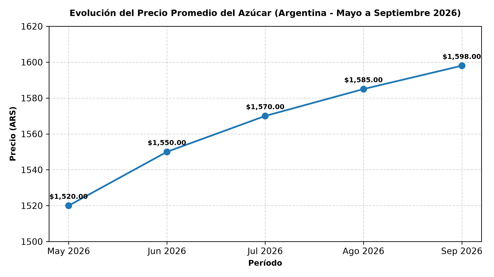

# Análisis Técnico: Evolución de Precios del Azúcar en Argentina (Mayo - Septiembre 2026)

## 📌 Descripción del Proyecto
Este repositorio contiene un análisis técnico comparativo de la evolución de los precios promedio del azúcar en el mercado argentino durante el período comprendido entre **mayo y septiembre de 2026**. El objetivo principal es contrastar y contrastar las series de precios oficiales con los registros de importación para evaluar tendencias y variaciones porcentuales.

---

## 📊 Visualización de Datos
El siguiente gráfico generado mediante **Python (Matplotlib)** resume la trayectoria alcista del precio promedio mensual expresado en Pesos Argentinos (ARS):



* **Período analizado:** Mayo 2026 – Septiembre 2026.
* **Tendencia observada:** Crecimiento sostenido desde los $1,520.00 ARS iniciales hasta los $1,598.00 ARS al cierre de septiembre.

---

## 🛠️ Stack Tecnológico y Herramientas
* **Microsoft Excel:** Limpieza inicial, estructuración del dataset principal y validación cruzada de registros.
* **Python (Matplotlib):** Procesamiento de series temporales y generación de gráficos de alta resolución (`dpi=300`) para documentación técnica.
* **Control de versiones:** Git & GitHub.

---

## 📂 Estructura del Repositorio
```text
├── grafico_azucar.py             # Script de Python para generar la visualización
├── evolucion_precio_azucar.png   # Gráfico exportado en alta resolución
└── README.md                     # Documentación oficial del proyecto
"Además de analizar los datasets históricos del INDEC, sumamos una etapa de automatización conectándonos a una API pública mediante un script en Python. Esto nos permite extraer datos directamente desde la web en formato JSON y estructurarlos de manera dinámica utilizando Pandas, cumpliendo con los requerimientos técnicos de integración de sistemas."

Technical Analysis: Evolution of Sugar Prices in Argentina (May - September 2026)
📌 Project Description
This repository contains a comparative technical analysis of the evolution of average sugar prices in the Argentine market during the period from May to September 2026. The main objective is to contrast official price series with import records in order to evaluate trends and percentage variations.

In addition to analyzing historical INDEC datasets, we added an automation phase by
connecting to a public API via a Python script. This allows us to extract data directly from the web in JSON format and structure it dynamically using Pandas, meeting the technical requirements for systems integration.

📊 Data Visualization
The following chart, generated using Python (Matplotlib), summarizes the upward trajectory of the average monthly price expressed in Argentine Pesos (ARS):

Analyzed period: May 2026 – September 2026.

Observed trend: Sustained growth from the initial $1,520.00 ARS up to $1,598.00 ARS by the close of September.

🛠️ Technology Stack & Tools
Microsoft Excel: Initial data cleansing, structuring of the primary dataset, and cross-validation of records.

Python (Matplotlib & Pandas): Time-series processing, dynamic JSON handling from public APIs, and generation of high-resolution charts (dpi=300) for technical documentation.

Version Control: Git & GitHub.

📂 Repository Structure
├── grafico_azucar.py             # Python script to generate the visualization and fetch API data
├── evolucion_precio_azucar.png   # High-resolution exported chart
└── README.md                     # Official project documentation